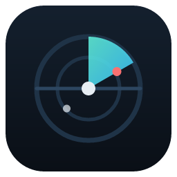

<p align="center">
  
</p>

<h1 align="center">Crowsnest</h1>

<p align="center">A fast, private match monitor for World of Warships.</p>

When a battle loads, Crowsnest shows every player on both teams with their ship, win rate, battles, personal rating, average damage and more, side by side. It runs entirely on your PC: no account, no login, no telemetry, and no server in between you and Wargaming.

## Features

- Finds your game automatically through Wargaming Game Center, the Windows uninstall registry, Steam, and the default install folders. If it cannot, it tells you and lets you pick the folder.
- Picks up a new battle within a second of the game writing it, then fills in stats as they arrive.
- Account and current-ship statistics, with optional solo (unplatooned) numbers.
- Personal rating using the wows-numbers.com formula and expected values.
- Colour tiers in three palettes, Muted, Vibrant and Colour-blind friendly, that meet contrast guidelines in dark and light themes, with the tier name always available in text.
- Team averages as mean, weighted, or median.
- Compact and comfortable densities, three text sizes, tray mode, and a title-bar pin for always on top.
- A short onboarding on first launch and after updates, with an appearance walkthrough, and live previews of each appearance option in Settings.
- Signed automatic updates from GitHub Releases.

## Privacy

Crowsnest talks to exactly three places, all over HTTPS:

| Where | What is sent | Why |
|---|---|---|
| Wargaming API (`api.worldofwarships.eu`, `.com`, `.asia`) | Player names and account ids from your current battle, and the application id | To fetch public statistics |
| wows-numbers.com | Nothing; a plain download | Expected values for personal rating, at most daily |
| GitHub | Nothing beyond the request itself | Update check, which you can turn off |

Settings and caches live in your user profile. Player statistics are kept in memory only. Details are in [docs/adr/0001-stack-and-data-sources.md](docs/adr/0001-stack-and-data-sources.md).

## Install

Download the latest `Crowsnest_x.y.z_x64-setup.exe` from [Releases](https://github.com/SatanshuMishra/crowsnest/releases/latest) and run it. It installs per user, without administrator rights. Crowsnest updates itself after that.

Replays must be enabled in the game (they are by default), because the game only writes the battle roster when it records a replay.

### Wargaming application id

Official builds include an application id. If you build Crowsnest yourself, or want to use your own id, create a **Standalone** application at [developers.wargaming.net](https://developers.wargaming.net/applications/) and paste its id under Settings.

## Development

Requirements: Node.js 22 or newer, Rust stable, and the Microsoft Edge WebView2 runtime (part of Windows 11).

```powershell
npm ci
npm run tauri dev
```

Checks that CI runs:

```powershell
npm run check
npm test
cargo fmt --manifest-path src-tauri/Cargo.toml --all -- --check
cargo clippy --manifest-path src-tauri/Cargo.toml --all-targets -- -D warnings
cargo test --manifest-path src-tauri/Cargo.toml
```

To build with an application id baked in, set `CROWSNEST_WG_APPLICATION_ID` before building. Releases are described in [docs/releasing.md](docs/releasing.md).

## Credits

- Statistics: Wargaming public API. World of Warships and all related names are trademarks of Wargaming.net. © Wargaming.net. All rights reserved. Crowsnest is not affiliated with or endorsed by Wargaming.
- Personal rating formula and expected values: [WoWS Numbers](https://wows-numbers.com/).
- Install detection approach informed by [wows-toolkit](https://github.com/landaire/wows-toolkit) (MIT).
- Crowsnest is an independent, clean-room reimplementation of the idea behind wows-monitor. No code from wows-monitor was used.

## License

[Apache License 2.0](LICENSE). Copyright 2026 Satanshu Mishra. Version 1.0.0 was released under the MIT License.
