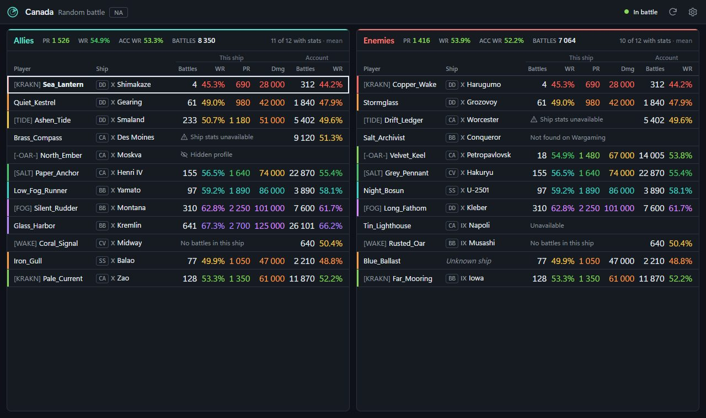
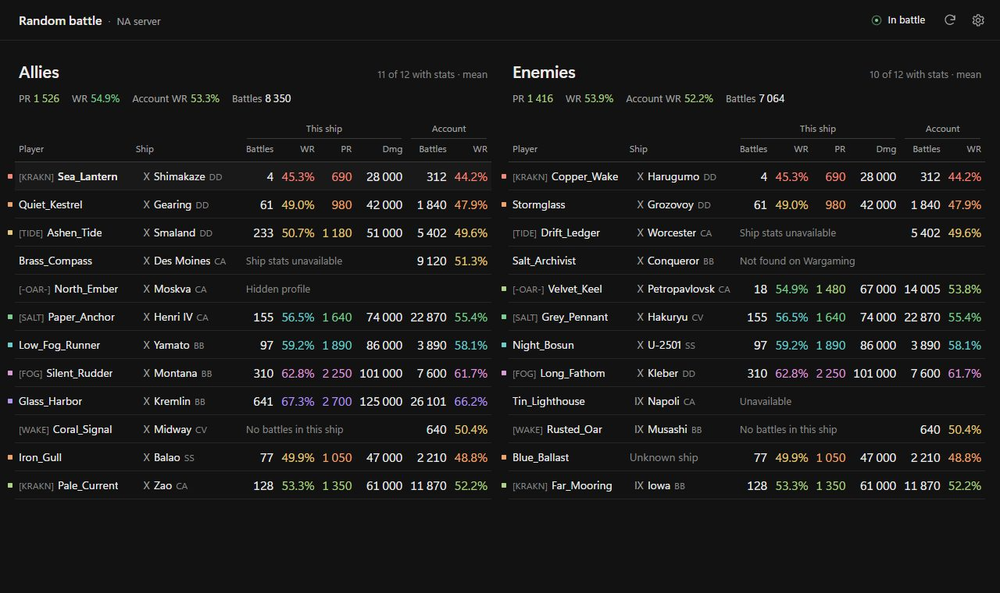
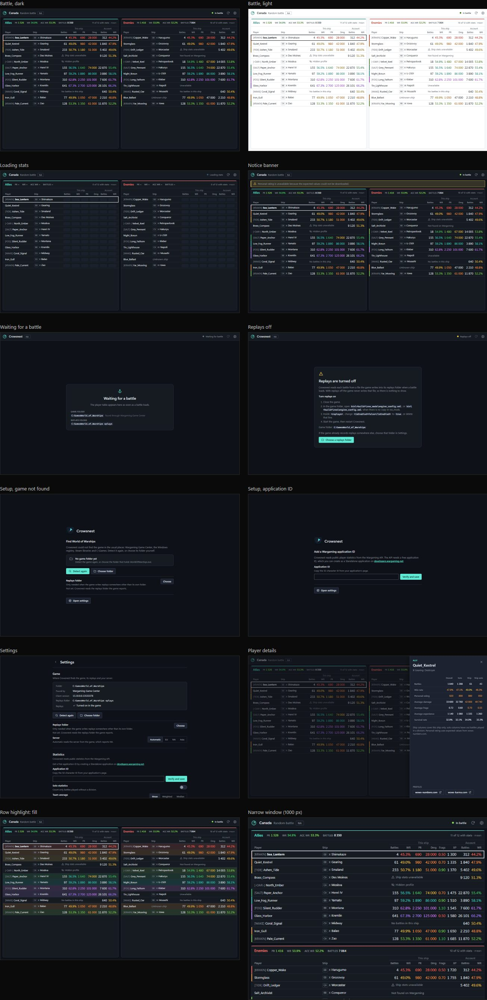
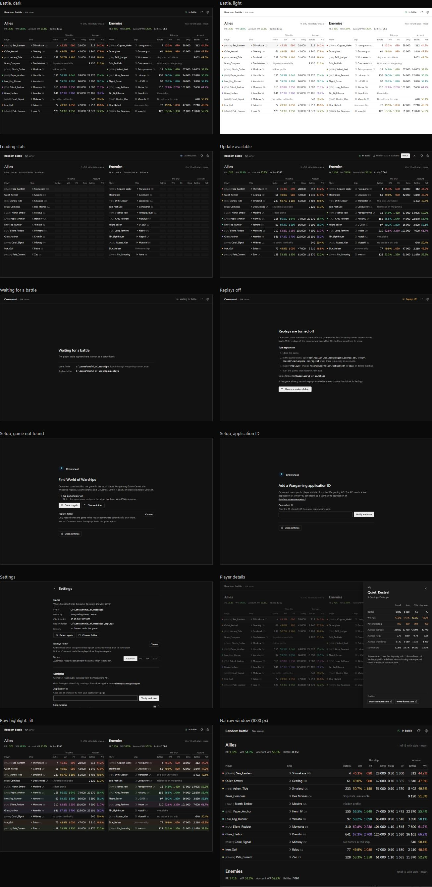

# Ledger redesign

The v0.1 interface worked but read as machine-made: it was assembled from common dashboard defaults rather than designed for a few-second glance from a second monitor. The Ledger redesign keeps every piece of data and every state, and moves the hierarchy from boxes and colour to type, position and hairline rules. `DESIGN.md` describes the resulting system; this note records why it changed.

## What read as AI-made, and what replaced it

| Trait in v0.1 | Ledger |
|---|---|
| GitHub Primer greys with Tailwind teal as the accent | Neutral greys with no blue cast; the accent is ink, so primary controls invert text and background |
| About 85 of 100 numbers coloured, in eight saturated hues | Only win rate and personal rating are coloured, in the same eight hues softened to near-equal lightness; damage and frags stay plain |
| One colour meaning three things (teal was brand, Allies and "great"; red was Enemies, "bad" and errors) | Teams carry no colour; colour means a tier or a status, nothing else |
| Accent stripes on rows, team cards and notices | A small tier-coloured square in the gutter, or a row tint, or nothing, as the user chooses |
| Rounded cards around teams, empty states and install details | Tables set straight on the window; states are left-aligned text in a reading column |
| More than 30 small chips: class badges, region chip, Solo pill, update pill | Plain faint text ("DD", "NA server", "· solo") |
| Uppercase eyebrow labels | Normal-case 12 px muted labels |
| Centred icon-heading-sentence empty states | One heading and one paragraph, no icon |
| Five sizes squeezed between 11 and 20 px, weight 600 in about 30 rules | Five sizes from 12 to 22 px; regular weight for reading, strong only for titles and your own name |
| Your row drawn with a white outline that read as "selected" | A quiet fill and your name in the strong weight |
| Status-page dots | A small radar glyph that sweeps while waiting or loading and holds steady in battle; the status is always written beside it |

## Other changes

- The map name is gone and the region reads "NA server", so nothing on screen suggests the app knows where the user is.
- Refresh spins for at least 700 ms, then cools down for 10 seconds with a visible countdown. The button stays focusable and its label says when it is available again.
- Screens, new battles, arriving values and the player sheet fade or slide in briefly; all of it stops under reduced motion.
- Each view's scroll panel is now the positioning parent for its contents. In v0.1, visually hidden labels inside Settings escaped the panel and made the whole page scroll as well, which showed a second scrollbar.

## Before and after

The battle view at the default 1280 by 760 window, dark theme.

Every state side by side: battle in both themes, compact density, row fill, loading, waiting, setup, replays off, settings and the player sheet.

## Checked

- Type check and 129 unit tests pass, including the new refresh cooldown tests.
- axe-core finds no WCAG 2.2 AA violations in the battle (dark, light and row fill), waiting, replays-off, setup, settings (both themes) and player sheet (both themes) states.
- Every tier colour and every text colour meets 4.5:1 on every surface it sits on, in both themes.
- Nothing clips at 1280 px; between 1100 and 1280 px the longest names end in an ellipsis, as in v0.1, and the player sheet shows them in full.
- No view scrolls the page at 1280 by 760 or 900 by 480; only each view's own panel scrolls.
